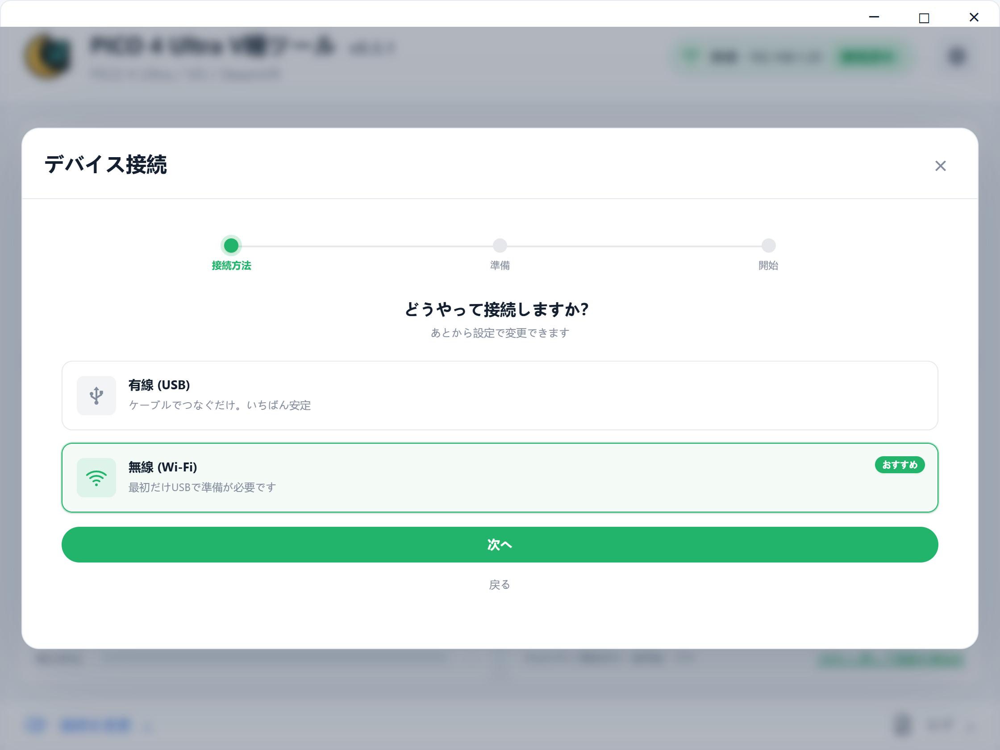
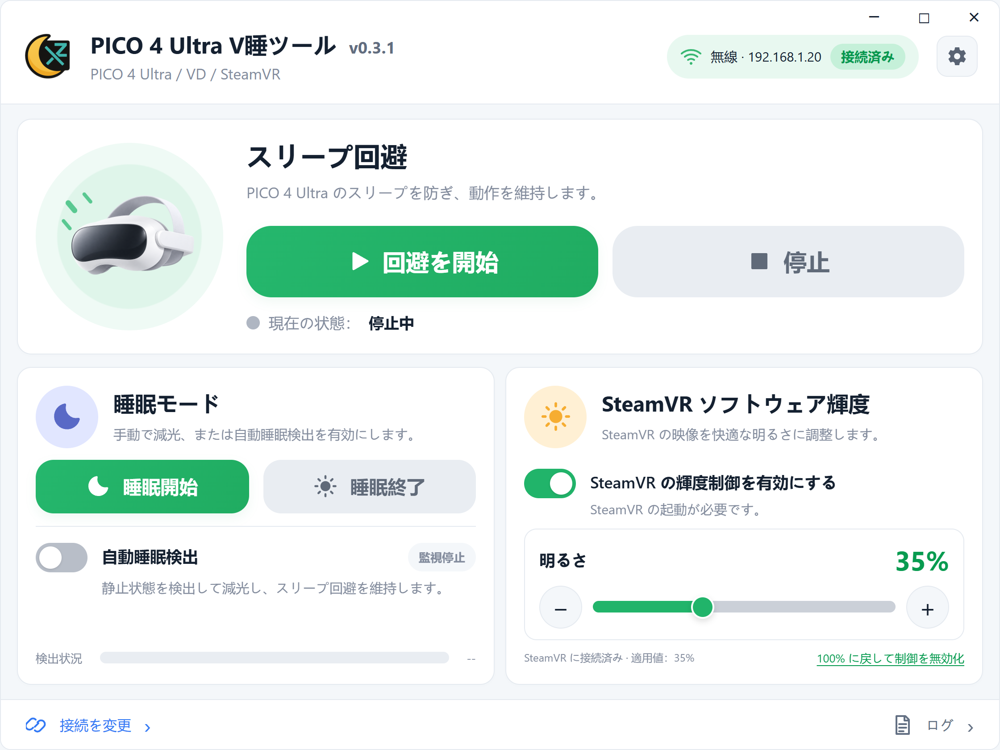
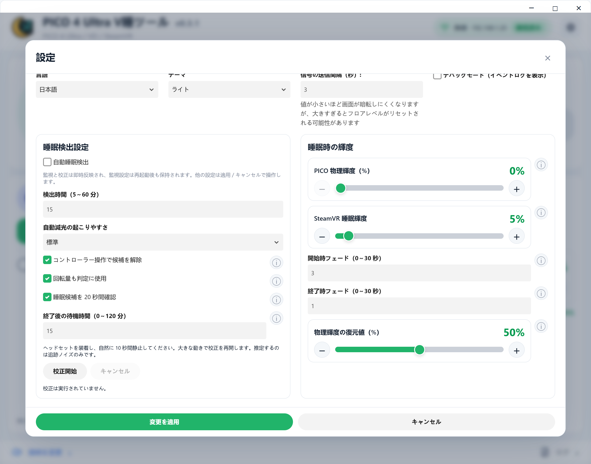

# PICO 4 Ultra V睡ツール

WindowsでPICO 4 Ultraを長時間使用するためのツールです。USB／無線ADBによるスリープ回避、睡眠時の減光、SteamVR映像の輝度調整に対応します。

[English](../README.md) · [简体中文](README_zh-CN.md) · [インストーラー](https://github.com/TSFAJR/pico4u-vr-sleep-workaround/releases)

## 機能と仕組み

| 機能 | 仕組み |
| --- | --- |
| スリープ回避 | 初期設定では3秒ごとにADBで電源状態を確認し、起動状態と報告されない場合に `input keyevent 224` を送信します。スリープ後の復帰処理であり、システムのスリープ機能を無効にはしません。 |
| USB／無線接続 | ヘッドセットとデバッグ許可を確認します。USBで無線ADBを設定した後は、IPアドレスで接続します。自動再接続にも対応します。 |
| 手動睡眠モード | 復元情報を保存し、`cmd display set-brightness` でバックライトを下げ、独立したSteamVR睡眠輝度を適用します。 |
| 自動睡眠検出 | OpenVRで頭の動きを取得し、校正後の移動量、任意の回転判定、コントローラー入力から低活動状態を判定します。設定時間後に減光し、確認待ちと終了後の待機時間も設定できます。 |
| SteamVR輝度 | 独立した補助プロセスが両眼を覆う頭部追従の黒いOpenVRオーバーレイを表示し、透明度で0～100%の減光を行います。±1%調整とフェードに対応。バックライトは変更せず、OyasumiVRのインストール、MQTT、Rootも不要です。 |
| 輝度復元 | 睡眠終了時に保存したソフト輝度とバックライトを復元します。正確なバックライト復元ができない場合は設定値（初期値50%）を使用し、失敗時は再試行できます。100%への復元ボタンはSteamVR減光のみを解除します。 |
| デスクトップ操作 | コントローラーのマウス入力による移動と多重起動防止に対応。機能動作中の終了は確認を表示し、本ツールの処理と補助プロセスを終了します。 |
| 設定とログ | 日本語・英語・簡体中国語、ライト／ダークテーマ、ⓘの説明、動作ログに対応します。 |

### スリープ回避の動作と制限

各周期でADB接続を確認してから `dumpsys power` を実行します。出力に `mWakefulness=Awake` があれば復帰コマンドを送信しません。それ以外の場合（電源状態の取得失敗を含む）は `input keyevent 224`（`KEYCODE_WAKEUP`）の送信を試みます。接続確認に失敗した周期では、復帰コマンドまで進みません。

現在の方式は定期的な状態確認と復帰であり、常時ウェイクロックを保持したり、PICOのスリープ設定を変更したりするものではありません。確認の合間に画面が消え、次の確認で復帰することがあります。ADBの遅延や再接続によって消灯時間が延びる場合もあります。間隔を短くすると待ち時間を減らせますが、画面・ストリーミング・音声の連続動作は保証できません。Androidでは、既に起動状態のデバイスに復帰キーを送っても効果がないと定義されています。繰り返し送信してもスリープタイマーをリセットできるとは限りません（[Android公式説明](https://developer.android.com/reference/android/view/KeyEvent#KEYCODE_WAKEUP)）。

本アプリの「睡眠モード」は輝度を下げる機能であり、Androidをスリープさせる操作ではありません。自動睡眠検出による減光と、ADBによる確認・復帰ループは別々に動作します。

## 使い方

### 1. ヘッドセットを接続する

最初にヘッドセットで開発者モードとUSBデバッグを有効にします（システムのバージョンによってメニュー名が異なる場合があります）。

1. **設定 > 一般 > デバイス情報**を開きます。
2. **ソフトウェアバージョン**を7回選択し、開発者モードを有効にします。
3. **設定 > 開発者**に戻り、**USBデバッグ**を有効にします。
4. データ通信対応のUSBケーブルでPCに接続します。ヘッドセットを装着し、**USBデバッグを許可**で許可してください。**常に許可**の選択を推奨します。

- **有線：** 有線（USB）を選び、確認を完了します。使用中はケーブルを接続したままにします。
- **無線：** PCとヘッドセットを同じLANに接続します（PCは有線LANでも可）。USBで無線設定を完了してからケーブルを外します。ヘッドセット再起動後は通常、無線ADBの再設定が必要です。
- **IP固定を推奨：** ルーターの管理画面で **DHCP予約／固定リース（IPとMACの紐付け）** を設定し、ヘッドセットに同じIPを割り当ててください。IP変更による再接続失敗を減らせます。ランダムMAC使用時は、そのネットワークではMACを固定してください。IP固定だけでは無線ADBの許可は不要になりません。

### 2. スリープ回避と減光を開始する

「回避を開始」を押します。すぐに減光する場合は「睡眠開始」、自動で減光する場合は「自動睡眠検出」を有効にします。ホーム画面のSteamVR手動輝度は独立しています。使用前にSteamVRを起動し、ヘッドセットを接続してください。

### 3. 睡眠輝度と検出を設定する

歯車から2種類の睡眠輝度、検出時間、減光の起こりやすさ、フェード時間を設定します。装着したまま自然に約10秒間静止して校正します。ⓘはホバーまたはクリックで説明を表示します。通常の設定は「変更を適用」で保存し、監視と校正は即時反映されます。

休憩後は「睡眠終了」で輝度を復元します。スリープ回避は継続します。使用を終えるときは回避を停止するかアプリを終了してください。

> 静止だけでは入眠を断定できません。VDのデスクトップモードでは頭の動きを取得できても、ボタン入力は取得できない場合があります。装着検出はランタイムに依存します。最低バックライトでも光が残る場合があります。SteamVRの0%はPC側のアプリから復元できます。

画像は現在のUIにデモデータを表示したものです。開発とビルドは [CONTRIBUTING](../CONTRIBUTING.md) を参照してください。
