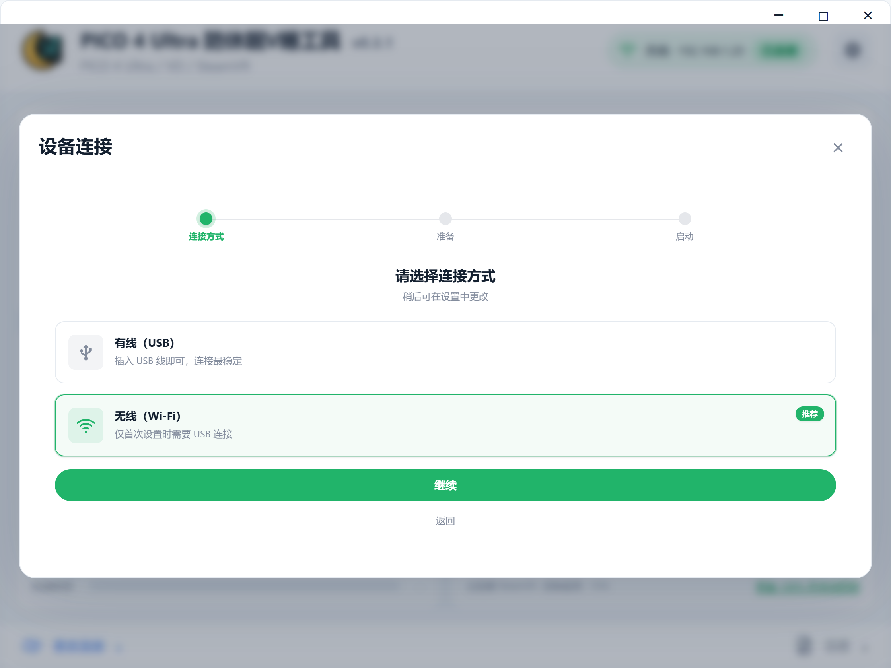
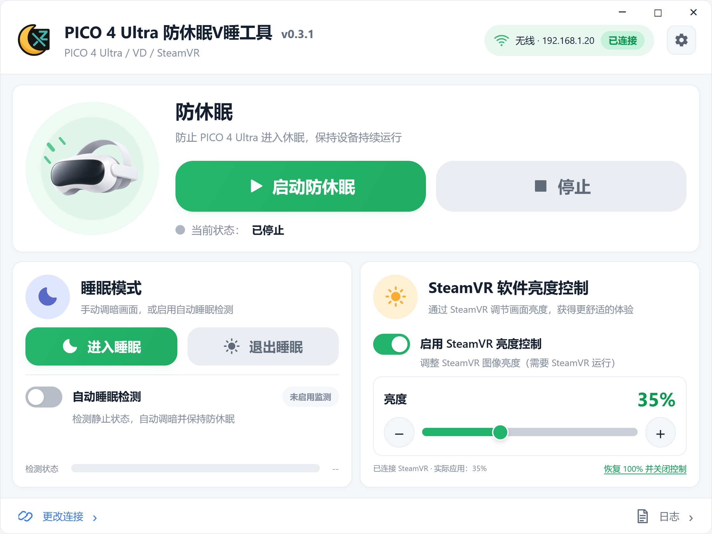
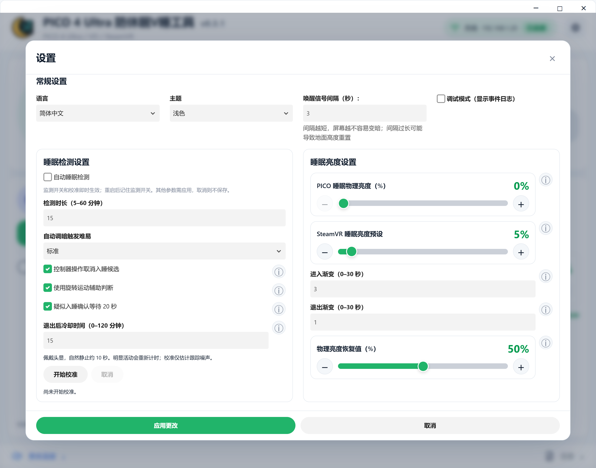

# PICO 4 Ultra 防休眠V睡工具

适用于 Windows 上的 PICO 4 Ultra 长时间 VR 使用与 V 睡场景，支持 USB／无线 ADB、防休眠、睡眠调暗和 SteamVR 画面亮度控制。

[English](../README.md) · [日本語](README_ja.md) · [下载安装包](https://github.com/TSFAJR/pico4u-vr-sleep-workaround/releases)

## 功能与原理

| 功能 | 实现方式 |
| --- | --- |
| 防休眠 | 通过 ADB 定期发送 `input keyevent 224` 唤醒信号，默认每 3 秒一次。 |
| USB／无线连接 | 检查头显与调试授权；通过 USB 开启无线 ADB 后，使用头显 IP 连接，并支持自动重连。 |
| 手动睡眠模式 | 保存恢复记录，通过 `cmd display set-brightness` 调低头显背光，同时应用独立的 SteamVR 睡眠亮度预设。 |
| 自动睡眠检测 | 通过 OpenVR 采集头显运动，结合校准后的移动量、可选转头及手柄输入判断持续低活动；达到时长后自动调暗。支持确认等待与退出后的冷却时间。 |
| SteamVR 软件亮度 | 独立辅助进程使用跟随头显的双眼黑色 OpenVR Overlay，通过透明度实现 0–100% 调光；支持 ±1% 微调及渐变，不改变物理背光。无需安装 OyasumiVR、MQTT 或 Root。 |
| 亮度恢复 | “退出睡眠”恢复记录中的软件亮度和头显背光；无法精确还原背光时使用设置的恢复值，默认 50%。恢复失败可重试。“恢复 100%”仅取消 SteamVR 调暗。 |
| 桌面操作 | 支持手柄模拟指针拖动、禁止重复启动；有任务运行时退出会提示，并清理本工具的任务和辅助进程。 |
| 设置与日志 | 简体中文／英文／日文、明暗主题、ⓘ 帮助说明与运行日志。 |

## 使用流程

### 1. 连接头显

先在头显中开启开发者模式和 USB 调试（菜单名称可能因系统版本略有不同）：

1. 打开“设置 > 通用 > 关于”。
2. 连续点击“软件版本”7 次，开启开发者模式。
3. 返回“设置 > 开发者”，开启“USB 调试”。
4. 用支持数据传输的 USB 线连接头显与电脑，戴上头显，在“允许 USB 调试”提示中选择“允许”，建议勾选“始终允许”。

- **有线**：选择“有线（USB）”，完成检查，使用期间保持插线。
- **无线**：电脑和头显连接同一局域网（电脑可用网线），先通过 USB 完成无线设置；显示成功后再拔线。头显重启后通常需要重新设置无线 ADB。
- **建议固定 IP**：在路由器后台为头显设置 **DHCP 地址保留／静态租约（IP 与 MAC 绑定）**，让它每次获得相同 IP，减少自动重连失败。若头显使用随机 MAC，应为该网络固定 MAC。固定 IP 不会代替无线 ADB 授权。

### 2. 启动防休眠，按需调暗

点击“启动防休眠”。需要立即休息时点击“进入睡眠”；需要自动调暗时开启“自动睡眠检测”。SteamVR 手动亮度在主页独立控制，使用前先运行 SteamVR 并连接头显。

### 3. 设置睡眠预设与检测参数

点击右上角齿轮，设置两种睡眠亮度、检测时长、触发难易及渐变时间。戴好头显，自然静止约 10 秒完成校准；ⓘ 可悬停查看或点击展开。普通参数需“应用更改”，监测开关及校准即时生效。

休息结束后点击“退出睡眠”，防休眠仍继续运行。结束使用时停止防休眠或关闭应用。

> 自动检测依据活动量，不能确认人是否睡着。VD 桌面模式下仍可读取头显运动，但手柄按键可能不可用；佩戴检测能力由运行时决定。0% 背光仍可能微亮，SteamVR 0% 可在电脑窗口恢复。

截图为当前界面的演示数据。开发与构建见 [CONTRIBUTING](../CONTRIBUTING.md)。
