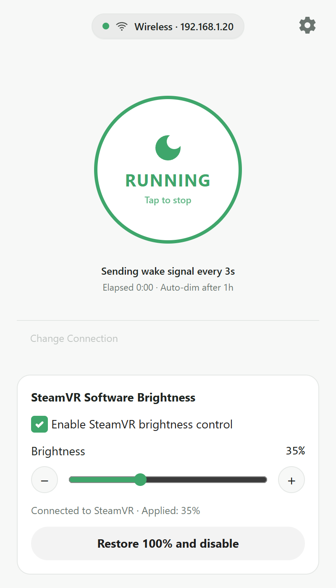
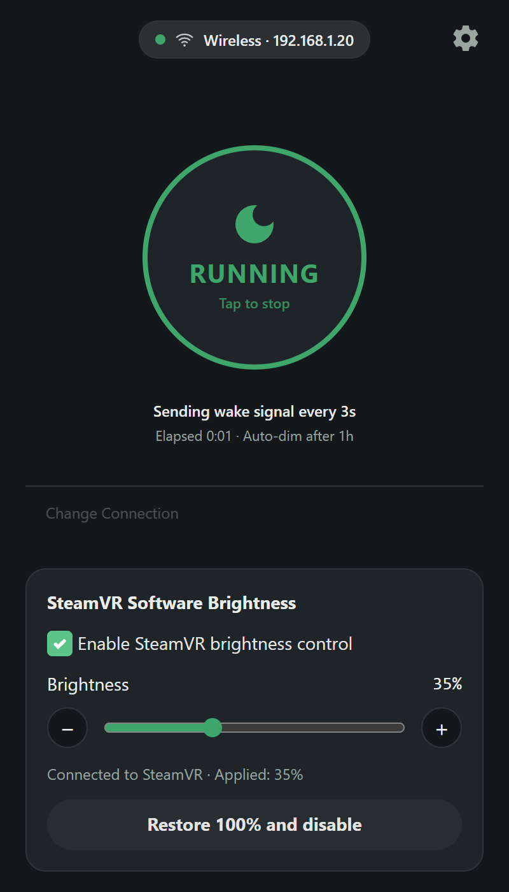
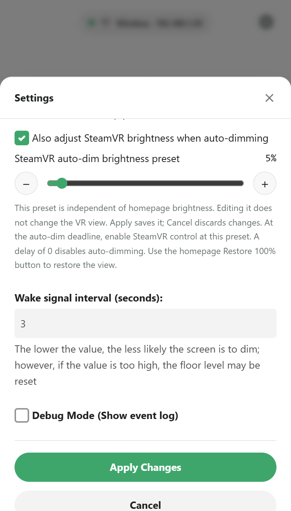
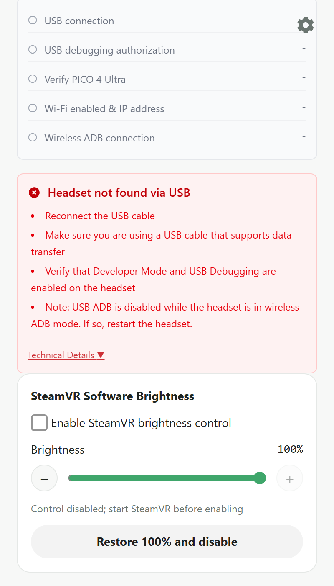
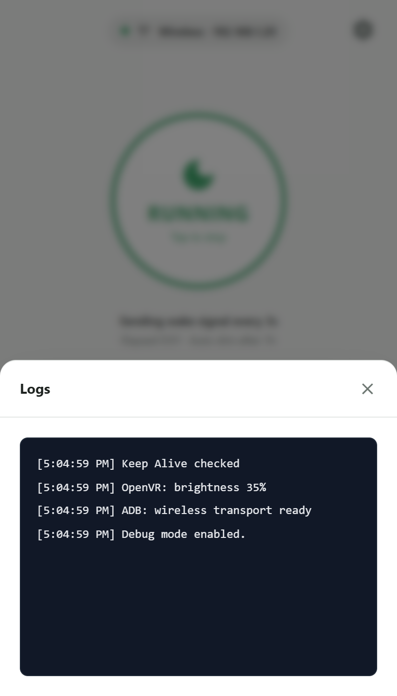
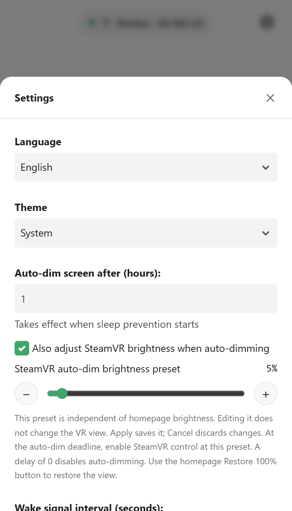

<h1>
  
  pico4u-vr-sleep-workaround
</h1>

pico4u-vr-sleep-workaround is a workaround tool designed to prevent the Pico 4 Ultra VR headset from going to sleep during development or specific use cases. It operates by periodically sending a keep-alive signal via ADB.

[日本語版（Japanese Version）はこちら](.github/README_ja.md)

[简体中文说明](.github/README_zh-CN.md)

## 🌟 Features

- **SteamVR software brightness**: Independent 0–100% dimming on the homepage, ±1% fine adjustment and a Windows restore button. Optional auto-dimming uses a separate brightness preset. See [SteamVR setup and recovery](README_STEAMVR.md).

- **Keep-Alive Signal**: Prevents the headset from entering sleep mode by sending the `keyevent 224` (wake up) command at a configurable interval (default: 3 seconds).
- **Connection Modes**: Supports both Wired (USB) and Wireless (TCP/IP) ADB connections.
- **Device Validation**: Automatically detects the connected device and verifies it is a Pico 4 Ultra (checks for `A9210` in the model name).
- **Auto-Dimming**: Optionally dims the headset's screen brightness to the lowest level (`1`) after a configurable delay (in hours) to prevent screen burn-in and save power.
- **Multi-language Support**: User Interface is available in English, Japanese, and Simplified Chinese. The initial language follows your system; change it in Settings and click Apply Changes to save your choice.

## 📸 Screenshots

Current UI at 400×700, captured at 2× resolution. Connection details, running state and logs use demonstration data; these screenshots illustrate the interface rather than a hardware test.

| Keep-awake and live SteamVR brightness | Dark theme |
| --- | --- |
|  |  |
| **Independent auto-dim preset** | **USB / wireless connection wizard** |
|  |  |
| **Connection error and troubleshooting** | **Event log** |
|  |  |

The homepage value (35% here) applies immediately; the settings preset (5% here) is saved separately with Apply Changes and only takes effect at the auto-dim deadline. Restore 100% leaves the preset unchanged.

Language, theme and general settings

## 🔧 Prerequisites: Enable USB Debugging

Before using the tool, you must enable Developer Mode and USB Debugging on your Pico 4 Ultra:
1. On your headset, go to **Settings > General > About**.
2. Click **Software Version** 7 times to enable Developer Mode.
3. Go back to **Settings > Developer** and toggle **USB Debugging** to ON.

## 🚀 Setup & Usage

1. Download the latest release for your platform (Windows `nsis` / `msi` installers are provided).
2. Install and launch the application.
3. Connect your Pico 4 Ultra via USB or Wi-Fi (if a USB debugging prompt appears in the headset, select "Allow").
4. Select your connection mode and click **Start Keep Alive**.

## 👨‍💻 For Developers

For information on how to set up the development environment, build the app from source, and contribute to the project, please refer to the [CONTRIBUTING.md](./CONTRIBUTING.md) guide.
