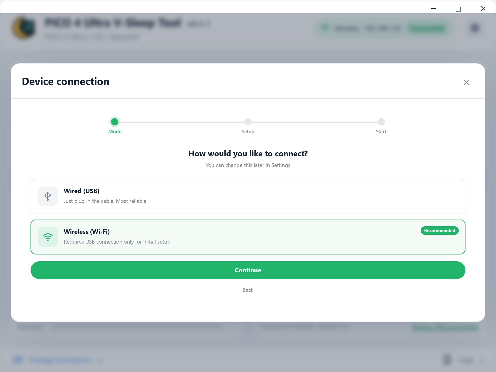
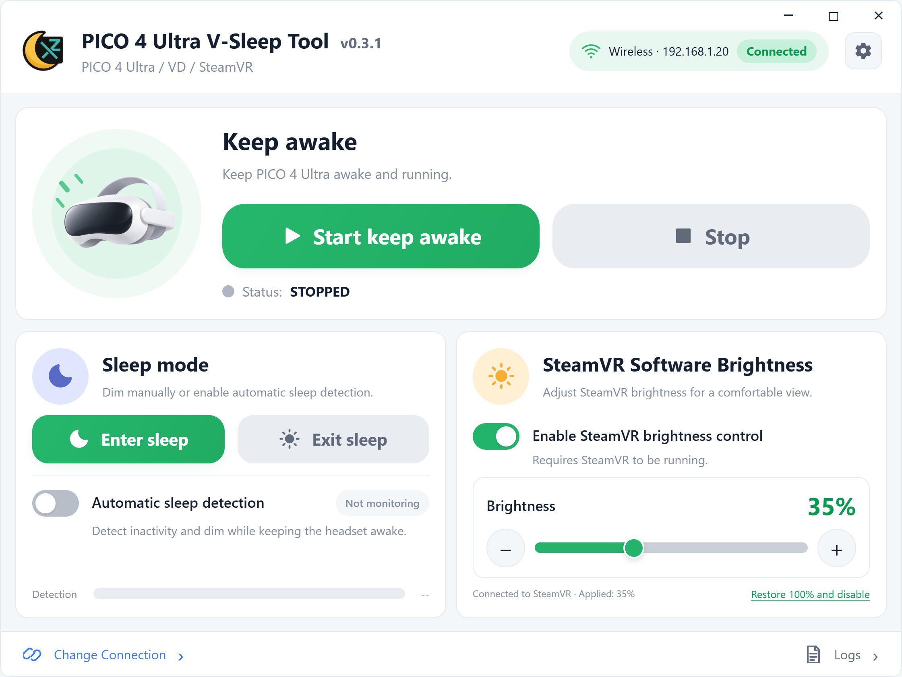
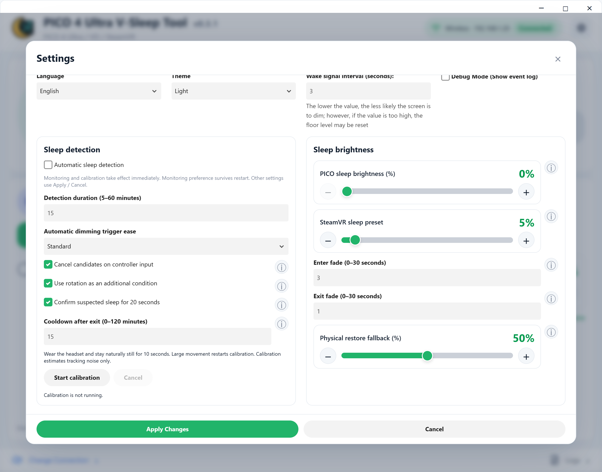

# PICO 4 Ultra V-Sleep Tool

A Windows tool for extended PICO 4 Ultra sessions and V-sleep, with USB/wireless ADB, keep-awake, sleep dimming and SteamVR brightness control.

[简体中文](.github/README_zh-CN.md) · [日本語](.github/README_ja.md) · [Download installers](https://github.com/TSFAJR/pico4u-vr-sleep-workaround/releases)

## Features and how they work

| Feature | Implementation |
| --- | --- |
| Keep awake | Sends `input keyevent 224` over ADB periodically, every 3 seconds by default. |
| USB / wireless connection | Checks the headset and debugging authorization. USB setup enables wireless ADB; subsequent connections use the headset IP, with automatic reconnection support. |
| Manual sleep mode | Saves recovery information, lowers headset backlight with `cmd display set-brightness`, and applies a separate SteamVR sleep brightness preset. |
| Automatic sleep detection | Samples headset motion through OpenVR. Calibrated movement, optional rotation and controller input determine sustained low activity, triggering dimming after the configured duration. Includes confirmation and cooldown settings. |
| SteamVR brightness | A separate helper uses a head-relative black OpenVR overlay covering both eyes. Opacity provides 0–100% dimming, ±1% adjustment and fades without changing backlight. No OyasumiVR installation, MQTT or root required. |
| Recovery | Exit sleep restores recorded software brightness and headset backlight. When exact backlight recovery is unavailable, it uses the configured fallback, default 50%. Failed recovery can be retried. Restore 100% only removes SteamVR dimming. |
| Desktop controls | Supports controller-emulated pointer dragging and single-instance operation. Exiting with active tasks asks for confirmation and cleans up this tool’s tasks and helper processes. |
| Settings and logs | English, Japanese and Simplified Chinese; light/dark themes, ⓘ explanations and activity logs. |

## Quick start

### 1. Connect the headset

Enable Developer Mode and USB Debugging on the headset first (menu names may vary by system version):

1. Open **Settings > General > About**.
2. Select **Software Version** seven times to enable Developer Mode.
3. Return to **Settings > Developer** and enable **USB Debugging**.
4. Connect the headset to the PC with a USB data cable. Put on the headset and accept **Allow USB debugging**; selecting **Always allow** is recommended.

- **USB:** select Wired (USB), complete the checks and keep the cable connected.
- **Wireless:** put the PC and headset on the same LAN (Ethernet is fine for the PC). Complete wireless setup over USB, then unplug after success. Headset restarts usually require wireless ADB setup again.
- **Reserve the headset IP:** configure a **DHCP reservation / static lease (IP-to-MAC binding)** in your router so the headset keeps the same IP. This reduces reconnection failures. If it uses a randomized MAC, keep a stable MAC for that network. An IP reservation does not replace wireless ADB authorization.

### 2. Start keep-awake and dim as needed

Select Start keep awake. Use Enter sleep for immediate sleep dimming, or enable Automatic sleep detection. Manual SteamVR brightness is independent on the homepage; start SteamVR and connect the headset before using it.

### 3. Configure sleep presets and detection

Open the gear button to set both sleep brightness presets, detection duration, trigger ease and fades. Wear the headset and remain naturally still for about 10 seconds to calibrate. Hover over ⓘ or click to expand help. Normal settings require Apply Changes; monitoring and calibration take effect immediately.

Use Exit sleep when finished resting; keep-awake continues. Stop keep-awake or close the app when ending your session.

> Low activity cannot prove sleep. VD desktop mode can still provide headset motion while controller button input may be unavailable; wearing detection depends on the runtime. Minimum backlight may still glow. SteamVR 0% can be restored from the Windows app.

Screenshots show the current UI with demonstration data. For development and builds, see [CONTRIBUTING](CONTRIBUTING.md).
